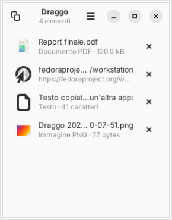

# Draggo

**Un cassetto temporaneo per il drag and drop su Linux/GNOME**, ispirato a [Yoink](https://eternalstorms.at/yoink/) per macOS.

Inizia a trascinare un file, un link, un testo o un'immagine: Draggo compare sul bordo dello schermo.
Rilascia l'elemento nel cassetto, chiudi pure l'app di origine, apri quella di destinazione e trascina l'elemento fuori dal cassetto.
Quando il cassetto si svuota, scompare da solo.



## Esempio tipico

Devi caricare un file su un sito, ma non hai il gestore file e il browser aperti uno accanto all'altro:

1. apri **File**, inizia a trascinare il documento e **Draggo appare** a destra dello schermo;
2. rilascialo nel cassetto e chiudi File;
3. apri il **browser** sulla pagina di caricamento;
4. trascina il documento da Draggo al sito. Il cassetto si svuota e sparisce.

## Funzionalità

- Compare automaticamente **appena inizi un trascinamento**, in qualsiasi applicazione.
- Resta visibile **finché contiene qualcosa**, poi si nasconde.
- Contiene **più elementi di tipo diverso** insieme:
  - **file e cartelle**: viene salvato solo il riferimento, nulla viene copiato o spostato;
  - **link**: da browser, email, chat…
  - **testi**: selezioni trascinate da editor, browser, terminale…
  - **immagini "grezze"**: salvate come PNG in `~/.local/share/draggo/files` ed eliminate quando escono dal cassetto.
- Trascina fuori **un elemento alla volta** o **tutti insieme** con la maniglia in alto a sinistra.
- Sempre in primo piano, su tutti gli spazi di lavoro, accanto al bordo dello schermo.
- **`Super+Alt+D`** apre o chiude il cassetto anche quando non stai trascinando nulla. La scorciatoia è configurabile.
- `Ctrl+V` incolla nel cassetto il contenuto degli appunti.
- Doppio clic su un elemento: lo apre con l'applicazione predefinita.
- Gli elementi vengono conservati anche dopo un riavvio (si può disattivare dal menu).
- Interfaccia in italiano o inglese, in base alla lingua di sistema.

## Come funziona

Su GNOME con Wayland una normale applicazione **non può sapere** che in un'altra finestra è iniziato un trascinamento: solo il compositor (GNOME Shell) lo sa. Per questo Draggo è composto da due parti:

| Componente | Ruolo |
|---|---|
| **App Draggo** (Python, GTK 4, libadwaita) | È il cassetto vero e proprio: riceve e fornisce i dati del drag and drop. Resta attiva in background con un consumo minimo. |
| **Estensione GNOME Shell** `draggo@albertosusco.github.io` | Rileva l'inizio e la fine di ogni trascinamento e lo comunica all'app tramite D-Bus. Tiene la finestra in primo piano, su tutti gli spazi di lavoro e sul bordo dello schermo. |

L'app espone le azioni `drag-begin` e `drag-end` sull'interfaccia `org.gtk.Actions` di D-Bus. Se l'app non è in esecuzione, viene avviata tramite D-Bus activation.

## Requisiti

- Fedora con GNOME 46 o successivi (pensato per GNOME 51, sessione Wayland)
- `python3-gobject`, `gtk4`, `libadwaita`: già presenti in Fedora Workstation

```bash
sudo dnf install python3-gobject gtk4 libadwaita
```

## Installazione

```bash
git clone https://github.com/albertosusco/draggo.git
cd draggo
./install.sh
```

Lo script installa tutto nella tua home (`~/.local`). Per installare Draggo per tutti gli utenti, in `/usr/local`, usa `sudo ./install.sh --system`.

GNOME Shell rileva le nuove estensioni solo al login. Quindi, la prima volta:

1. **esci e rientra** nella sessione;
2. abilita l'estensione:
   ```bash
   gnome-extensions enable draggo@albertosusco.github.io
   ```
   In alternativa puoi usare l'app **Estensioni**.

Da quel momento Draggo parte automaticamente al login e compare a ogni trascinamento.

### Disinstallazione

```bash
./uninstall.sh            # oppure: sudo ./uninstall.sh --system
```

## Impostazioni

**App** (menu ☰ del cassetto):
- *Rimuovi gli elementi dopo averli trascinati*: attiva di default. Un elemento trascinato con successo fuori dal cassetto viene tolto. Se lo disattivi, resta finché non lo rimuovi con ✕.
- *Conserva gli elementi al riavvio*.
- *Svuota cassetto* (`Ctrl+Canc`), *Incolla* (`Ctrl+V`).

**Estensione** (app Estensioni → Draggo → Impostazioni):
- posizione: destra, sinistra o centro;
- distanza dal bordo;
- ritardo prima della comparsa, per ignorare trascinamenti brevissimi;
- visibilità su tutti gli spazi di lavoro;
- scorciatoia da tastiera per mostrare o nascondere il cassetto (predefinita `Super+Alt+D`): premi *Modifica* e poi la nuova combinazione. *Backspace* la disattiva.

## Uso da riga di comando

```
draggo               mostra/nasconde il cassetto
draggo --show        mostra il cassetto
draggo --hide        nasconde il cassetto
draggo --background  avvia senza mostrare nulla
draggo --quit        chiude Draggo
```

Senza l'estensione, puoi comunque associare `draggo` a una scorciatoia in *Impostazioni → Tastiera → Scorciatoie personalizzate*.

## Sviluppo

```bash
python3 -m unittest discover -s tests          # test del modello
PYTHONPATH=src python3 -m draggo.main --show   # avvio dai sorgenti
```

Per i log dell'estensione:

```bash
journalctl -f -o cat /usr/bin/gnome-shell
```

Struttura:

```
src/draggo/      app (shelf.py = modello, dnd.py = conversione dati, window.py = UI)
extension/       estensione GNOME Shell
data/            file .desktop, servizio D-Bus, autostart, icone
```

## Limitazioni note

- Senza l'estensione l'app funziona lo stesso, ma il cassetto non compare da solo e `Super+Alt+D` non è disponibile: va aperto con il comando `draggo`.
- I file vengono conservati come riferimento: se sposti o elimini l'originale, l'elemento viene segnalato come "File non trovato".
- Quando trascini un'immagine da una pagina web, il browser di solito fornisce il **link** all'immagine e non il file.

## Licenza

GPL-3.0-or-later. Vedi [LICENSE](LICENSE).
